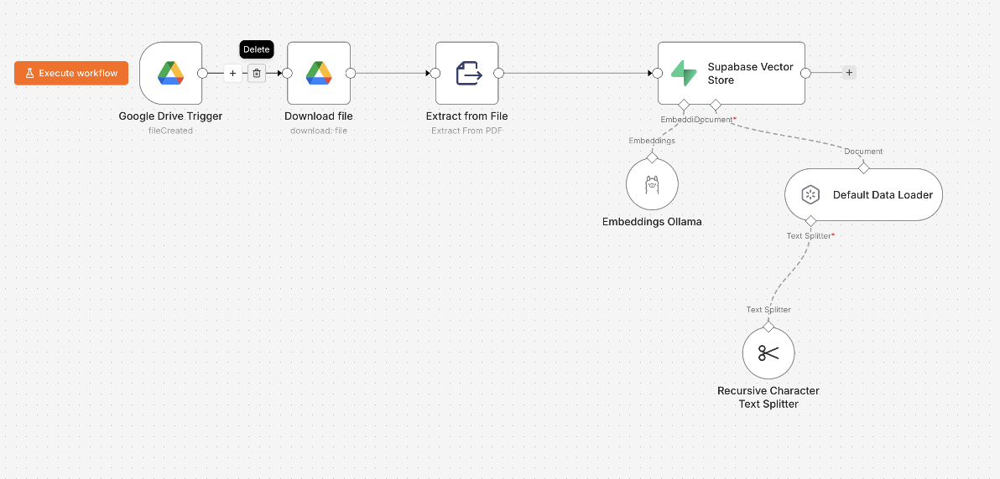
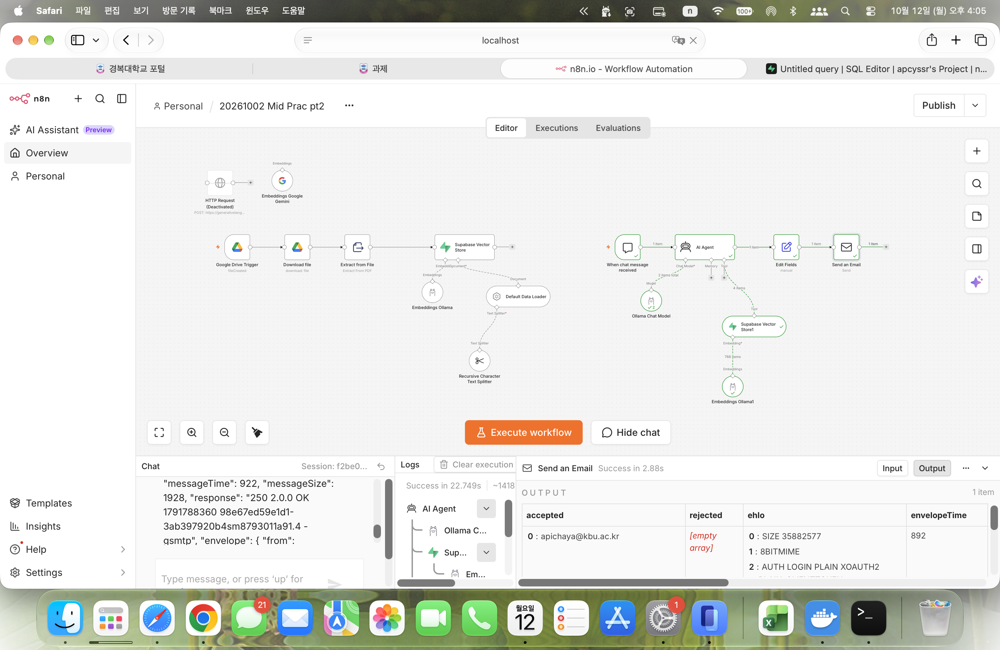
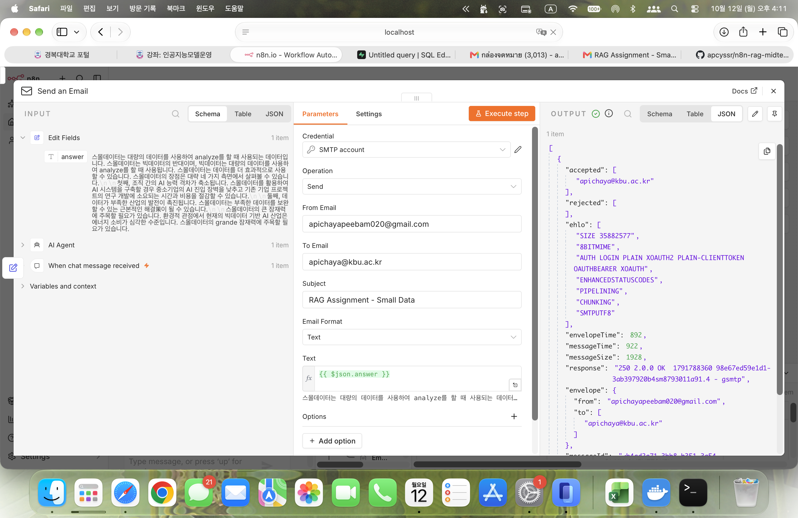
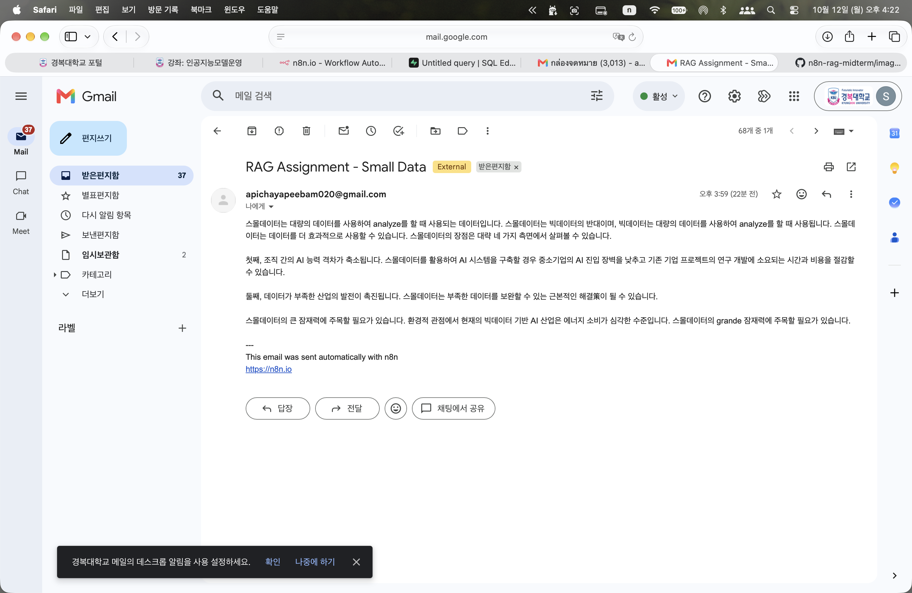

# RAG Assignment – Small Data

## 1. Overview

This project implements a Retrieval-Augmented Generation (RAG) workflow using n8n. It combines document processing, vector storage, and an AI-powered question-answering workflow to generate answers based on available information.

The workflow uses Ollama to run the language model, Supabase Vector Store to store and retrieve document embeddings, and an email automation node to deliver the generated answers.

## 2. Project Objectives

- Build a RAG workflow using n8n.
- Process documents and prepare them for retrieval.
- Store document embeddings in Supabase Vector Store.
- Generate answers using retrieved information and a language model.
- Automatically send generated answers through email.

## 3. Technologies Used

| Technology | Purpose |
|---|---|
| n8n | Workflow automation and orchestration |
| Ollama | Run the language model locally |
| Supabase Vector Store | Store and retrieve document embeddings |
| Google Drive | Provide source documents |
| Embeddings Model | Convert text into vector representations |
| SMTP / Email | Send AI-generated answers |
| RAG | Ground answers in retrieved document content |

## 4. Workflow Architecture

### 4.1 Document Ingestion

The document ingestion workflow prepares source documents for retrieval.

1. Google Drive Trigger detects the source file.
2. Download file retrieves the document.
3. Extract from File extracts the document content.
4. The Default Data Loader and Recursive Character Text Splitter prepare the text for processing.
5. Ollama Embeddings generates vector representations of the text.
6. Supabase Vector Store stores the embeddings for later retrieval.

### 4.2 Complete Workflow

The project connects document ingestion with an AI question-answering workflow.

When a user submits a question through the n8n chat interface, the AI Agent can use the Supabase Vector Store as a retrieval tool to find relevant information and generate an answer.

### 4.3 Email Automation

After the AI Agent generates an answer, the workflow passes the result to the email node. The email content is populated using the generated answer field.

The SMTP node sends the answer to the configured recipient.

## 5. Why Ollama?

Ollama was selected because it allows language models to run locally instead of relying entirely on an externally hosted LLM API.

The main reasons for choosing Ollama are:

- **Local execution:** Models can run on a local machine, reducing dependence on external inference services.
- **Privacy and data control:** Prompts and retrieved document content can be processed locally when the entire model workflow is configured locally. External services used by other workflow components may still process data.
- **Cost control:** Running a local model can avoid per-request LLM API charges, although hardware and electricity still have costs.
- **Flexible model selection:** Different supported models can be downloaded and tested for the project's requirements.
- **Integration with n8n:** Ollama can be connected to n8n's AI nodes to build an automated question-answering workflow.

### Ollama vs. Cloud LLM APIs

| Aspect | Ollama | Cloud LLM API |
|---|---|---|
| Execution | Runs models locally | Runs models on a provider's infrastructure |
| API usage fees | No per-request provider fee for local inference | May charge based on usage |
| Data handling | Can keep model inference local | Prompts are sent to the external provider |
| Hardware | Requires sufficient local resources | Less local hardware required |
| Internet dependency | Local inference can work offline after setup and model download | Usually requires internet access |
| Maintenance | User manages local models and resources | Provider manages model infrastructure |

For this project, Ollama provides a practical way to experiment with local LLM inference and RAG integration while reducing dependence on paid inference APIs.

However, local models may require more computer resources and may produce different results from larger hosted models.

## 6. Testing and Results

The workflow was tested by executing the email node after the AI Agent generated an answer.

The SMTP response indicated that the message was accepted by the mail server, and the recipient appeared in the accepted list with no rejected recipients.

The email was subsequently found in the Gmail Spam folder. This indicates that SMTP submission succeeded, but inbox delivery was not guaranteed.

## 7. How to Run

1. Set up n8n.
2. Install and run Ollama, then download a compatible language model.
3. Configure the Ollama connection in n8n.
4. Configure Supabase and create the required vector storage.
5. Set up the embedding model and connect it to the Supabase Vector Store.
6. Configure Google Drive access and the document ingestion workflow.
7. Configure the chat trigger and AI Agent.
8. Configure SMTP credentials for email delivery.
9. Execute the workflow and test it with a question related to the ingested documents.

**Note:** Exact model names, database configuration, credentials, and environment settings depend on the local setup.

## 8. Security Considerations

- Do not commit API keys, passwords, SMTP credentials, or access tokens.
- Use n8n credentials to store sensitive connection information.
- Avoid exposing private email addresses or sensitive document content in public screenshots.
- Review the repository before making it public.

## 9. Conclusion

This project demonstrates how n8n can integrate document ingestion, embeddings, vector search, local language model inference, and email automation into a RAG workflow.

Using Ollama makes local model experimentation possible, while Supabase Vector Store provides a way to retrieve relevant document content for AI-generated answers.

The project also demonstrates the importance of testing the complete workflow, including email delivery and spam filtering.

## Author

**Apichaya Saensiri**

GitHub Repository: [n8n-rag-midterm](https://github.com/apcyssr/n8n-rag-midterm)
